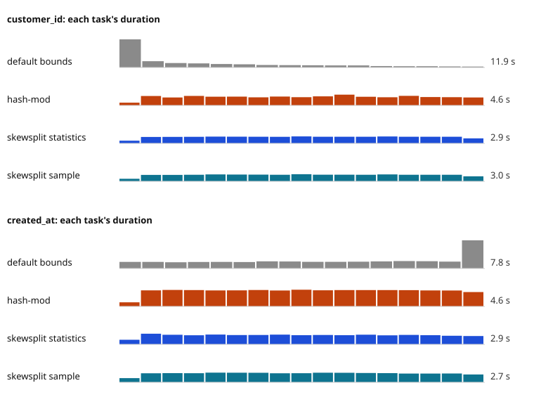

# Benchmark results

Written by `make bench` from a run of `.github/workflows/bench.yml`. See
[README.md](README.md) for what each method does.

- Table `bench_orders`: 15,000,000 rows from `bench/skewed_table.sql`, whose seed (`setseed(0.42)`) makes the data the same on every run, read in full into Spark's noop sink.
- 16 partitions. Each method ran 3 times, interleaved with the others; the times are medians. The sample strategy uses `--seed 1`. `ANALYZE` reads a random sample of its own, so the statistics strategy's plan can differ a little between runs.
- Spark 4.3.0 in local mode with 4 cores, Java 21.0.13, Python 3.14.4.
- PostgreSQL 18.7 (Debian 18.7-1.pgdg13+2) in a service container on the same runner (ubuntu26 20261116.88.1, 4 CPUs, 15 GB).
- From [this run of the Bench workflow](https://github.com/Diafyx/skewsplit/actions/runs/45030759209).

## `customer_id` (bigint)

| Method | Tasks | Rows per task (min / median / max) | Largest task | Planning | Max task time | Job time |
|--------|------:|-----------------------------------:|-------------:|---------:|--------------:|---------:|
| default bounds | 16 | 59,272 / 115,569 / 12,444,535 | 83% | 0.1 s | 11.9 s | 11.9 s |
| hash-mod | 17 | 149,331 / 869,180 / 1,514,943 | 10% | 0.0 s | 4.6 s | 15.3 s |
| skewsplit statistics | 17 | 149,331 / 921,379 / 1,013,049 | 7% | 0.0 s | 2.9 s | 12.0 s |
| skewsplit sample | 17 | 149,331 / 928,475 / 1,013,049 | 7% | 0.1 s | 3.0 s | 12.0 s |

skewsplit statistics against default bounds: +75% max task time, -1% job time (positive is faster).
skewsplit statistics against hash-mod: +35% max task time, +22% job time (positive is faster).

## `created_at` (timestamp)

| Method | Tasks | Rows per task (min / median / max) | Largest task | Planning | Max task time | Job time |
|--------|------:|-----------------------------------:|-------------:|---------:|--------------:|---------:|
| default bounds | 16 | 361,686 / 367,593 / 9,329,785 | 62% | 0.1 s | 7.8 s | 13.8 s |
| hash-mod | 17 | 150,776 / 927,860 / 930,708 | 6% | 0.0 s | 4.6 s | 18.7 s |
| skewsplit statistics | 17 | 150,776 / 926,720 / 979,502 | 7% | 0.0 s | 2.9 s | 11.2 s |
| skewsplit sample | 17 | 150,776 / 925,408 / 953,307 | 6% | 0.1 s | 2.7 s | 11.1 s |

skewsplit statistics against default bounds: +62% max task time, +19% job time (positive is faster).
skewsplit statistics against hash-mod: +36% max task time, +40% job time (positive is faster).
